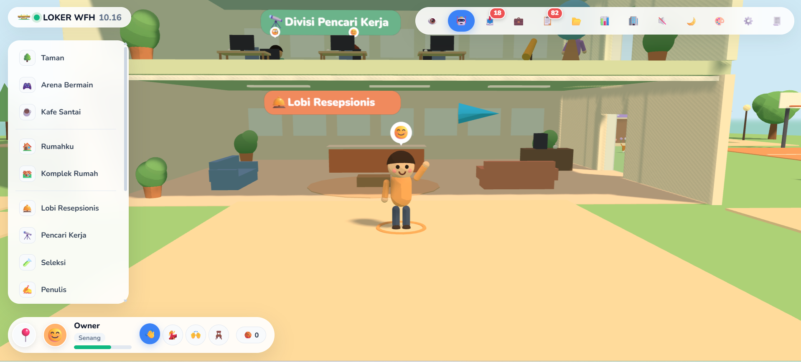

<p align="center"></p>

# Bot Loker WFH

A personal job-hunting bot that runs as a cozy 3D office. Virtual employees find remote jobs and freelance projects, score them against your CV, write cover letters and bids, and report to you on Telegram. Nothing important goes out without your approval.

[](docs/media/office-pov.mp4)

▶️ [Watch the 15-second POV tour](docs/media/office-pov.mp4)

**[English](#english)** · **[Bahasa Indonesia](#bahasa-indonesia)**

---

## English

### What it does

- **Job hunting.** Scouts fetch remote jobs from RemoteOK, Remotive, Kalibrr, Dealls, and the Greenhouse/Lever boards you register. Jobs are then scored against your skills and filtered for eligibility.
- **Freelance projects.** Projects come from Freelancer.com, Projects.co.id, and public Telegram channels. Cora drafts the proposal and suggests a price based on the project's budget. She cites only GitHub repos that match the project by at least 70%.
- **Approval first.** Job applications are prepared and form-filled, but the bot always stops before Submit. A freelance bid is sent only after you press **Setujui & kirim bid** (or under the auto-bid rules you set). Each bid is sent at most once, and Telegram tells you whether it succeeded or failed, with the full draft and price.
- **Employees that learn.** Your ratings and notes on their reports become lessons stored in Supabase, and those lessons reach their next prompts, meetings and break-time decisions.
- **3D office.** Walk around the office, chat with employees, give them standing instructions, read their reports, or switch to first-person view.

### Requirements

- Python 3.11 or newer
- A Supabase project (Postgres). Tables live in the `loker` schema.
- Optional: a Telegram bot token, an OpenAI-compatible LLM endpoint (9Router), Node.js 18+ for BrowserMCP form filling, and a Freelancer.com API token

### Quick start

```powershell
git clone <repository-url>
cd bot_loker_wfh
python -m venv .venv
.\.venv\Scripts\Activate.ps1          # macOS/Linux: source .venv/bin/activate
python -m pip install -e ".[dev]"

Copy-Item .env.example .env            # then fill in the values below
Copy-Item resume/profile.example.json data/profile.json   # your skills, experience, projects

python -m bot_loker_wfh init-db        # create/upgrade the database schema
python -m bot_loker_wfh office --port 8765
```

Open <http://127.0.0.1:8765> in your browser.

### Configuration (`.env`)

| Variable | Purpose |
|---|---|
| `SUPABASE_DB_URL` | **Required.** Session-pooler URI from Supabase → Connect. The direct host is IPv6-only. |
| `TELEGRAM_BOT_TOKEN`, `TELEGRAM_ALLOWED_CHAT_IDS` | Telegram control and notifications. Only allowlisted chat IDs are accepted. |
| `EXTERNAL_JOBS_ENABLED` | `false` by default. Set it to `true` to let scouts call the job APIs. |
| `FETCH_INTERVAL_HOURS` | Fetch cycle interval, minimum 4. |
| `LLM_PROVIDER`, `NINEROUTER_BASE_URL`, `NINEROUTER_API_KEY`, `NINEROUTER_MODEL` | The model that writes drafts. Use `template` for offline templates. |
| `GITHUB_USERNAME` | Your public repos, used as proof in bids. They re-sync every 6 hours. |
| `FREELANCER_ACCESS_TOKEN` | Sends approved Freelancer.com bids through the official API. |
| `FORM_ASSIST_ENABLED`, `BROWSER_MCP_COMMAND` | Form filling in your own Chrome. It always stops before Submit. |
| `LEAD_TELEGRAM_CHANNELS` | Public channels to read freelance leads from, comma-separated. |

Most of these can also be changed live from **⚙️ Setting** in the office.

### Running

| Command | What it does |
|---|---|
| `python -m bot_loker_wfh office --port 8765` | The 3D office: dashboard, employees, approvals, auto mode |
| `python -m bot_loker_wfh run-bot` | Long-running Telegram bot with scheduled fetch cycles |
| `python -m bot_loker_wfh fetch-once` | Fetch every source once |
| `python -m bot_loker_wfh fetch-leads` | Fetch freelance projects once |
| `python -m bot_loker_wfh sync-github` | Refresh your GitHub portfolio now |
| `python -m bot_loker_wfh draft-lead --lead-id <id>` | Draft a bid for one project |
| `python -m bot_loker_wfh check-llm` / `check-browser` | Check that the LLM and the browser are ready |

Run only one process that polls the same Telegram token at a time.

**Office controls:** `WASD` walk · click an employee to chat · `V` first-person view (drag to look around) · `E`/`Q` ride the lift · `Esc` close panels.

**Projects.co.id bids** use the bot's own browser window. Install it with `python -m pip install -e ".[form]"` and `python -m playwright install chromium`, then log in once in that window.

### Deploy with Docker

```bash
scp .env user@server:~/bot_loker_wfh/.env
scp -r data user@server:~/bot_loker_wfh/data
docker compose up -d --build        # runs `run-bot`
docker compose logs -f bot
```

### Tests

```powershell
python -m pytest -q -n 4
```

Tests need `SUPABASE_DB_URL` and run against a throwaway `t_*` schema, never your real tables. They never call real job APIs, Telegram, LLMs or browsers.

### Safety

- External job APIs stay off until `EXTERNAL_JOBS_ENABLED=true`.
- Telegram commands and buttons require an allowlisted chat ID. Stale or replayed callbacks do nothing.
- Logs contain no CV data, cover letters, tokens or provider error text.
- The bot never solves a CAPTCHA.

More detail is in [`docs/ONBOARDING.md`](docs/ONBOARDING.md).

---

## Bahasa Indonesia

### Apa yang dikerjakan

- **Mencari lowongan.** Para pemburu mengambil lowongan remote dari RemoteOK, Remotive, Kalibrr, Dealls, serta board Greenhouse/Lever yang kamu daftarkan. Setelah itu lowongan dinilai terhadap skill-mu dan disaring kelayakannya.
- **Proyek freelance.** Proyek diambil dari Freelancer.com, Projects.co.id, dan channel Telegram publik. Cora menulis proposal dan menyarankan harga berdasarkan budget proyek. Dia hanya mengutip repo GitHub yang cocok minimal 70% dengan proyek.
- **Persetujuanmu dulu.** Lamaran kerja disiapkan dan formnya diisi, tapi bot selalu berhenti sebelum Submit. Bid freelance hanya terkirim setelah kamu menekan **Setujui & kirim bid**, atau lewat aturan auto-bid yang kamu atur. Setiap bid terkirim paling banyak sekali, dan Telegram memberi kabar berhasil atau gagal lengkap dengan draf dan harganya.
- **Karyawan yang belajar.** Nilai dan catatanmu pada laporan mereka disimpan di Supabase sebagai pelajaran, lalu dipakai di prompt, rapat, dan keputusan mereka berikutnya.
- **Kantor 3D.** Jalan-jalan di kantor, ngobrol dengan karyawan, beri instruksi tetap, baca laporan, atau pindah ke mode POV.

### Kebutuhan

- Python 3.11 ke atas
- Proyek Supabase (Postgres). Tabel ada di schema `loker`.
- Opsional: token bot Telegram, endpoint LLM yang kompatibel OpenAI (9Router), Node.js 18+ untuk pengisian form BrowserMCP, dan token API Freelancer.com

### Cara menjalankan

```powershell
git clone <repository-url>
cd bot_loker_wfh
python -m venv .venv
.\.venv\Scripts\Activate.ps1          # macOS/Linux: source .venv/bin/activate
python -m pip install -e ".[dev]"

Copy-Item .env.example .env            # lalu isi nilai-nilai di bawah
Copy-Item resume/profile.example.json data/profile.json   # skill, pengalaman, proyekmu

python -m bot_loker_wfh init-db        # buat/perbarui schema database
python -m bot_loker_wfh office --port 8765
```

Buka <http://127.0.0.1:8765> di browser.

### Pengaturan (`.env`)

| Variabel | Fungsi |
|---|---|
| `SUPABASE_DB_URL` | **Wajib.** URI session pooler dari Supabase → Connect. Host langsung hanya IPv6. |
| `TELEGRAM_BOT_TOKEN`, `TELEGRAM_ALLOWED_CHAT_IDS` | Kontrol dan notifikasi Telegram. Hanya chat ID yang di-allowlist yang diterima. |
| `EXTERNAL_JOBS_ENABLED` | Bawaannya `false`. Ubah ke `true` agar pemburu boleh memanggil API lowongan. |
| `FETCH_INTERVAL_HOURS` | Jeda siklus pencarian, minimal 4 jam. |
| `LLM_PROVIDER`, `NINEROUTER_BASE_URL`, `NINEROUTER_API_KEY`, `NINEROUTER_MODEL` | Model penulis draf. Pakai `template` untuk template offline. |
| `GITHUB_USERNAME` | Repo publikmu sebagai bukti di bid. Disinkronkan ulang tiap 6 jam. |
| `FREELANCER_ACCESS_TOKEN` | Mengirim bid Freelancer.com yang disetujui lewat API resmi. |
| `FORM_ASSIST_ENABLED`, `BROWSER_MCP_COMMAND` | Pengisian form di Chrome milikmu. Selalu berhenti sebelum Submit. |
| `LEAD_TELEGRAM_CHANNELS` | Channel publik sumber lead freelance, dipisah koma. |

Sebagian besar juga bisa diubah langsung dari menu **⚙️ Setting** di kantor.

### Perintah

| Perintah | Fungsi |
|---|---|
| `python -m bot_loker_wfh office --port 8765` | Kantor 3D: dashboard, karyawan, persetujuan, mode auto |
| `python -m bot_loker_wfh run-bot` | Bot Telegram yang terus berjalan dengan siklus pencarian terjadwal |
| `python -m bot_loker_wfh fetch-once` | Ambil semua sumber sekali |
| `python -m bot_loker_wfh fetch-leads` | Ambil proyek freelance sekali |
| `python -m bot_loker_wfh sync-github` | Perbarui portofolio GitHub sekarang |
| `python -m bot_loker_wfh draft-lead --lead-id <id>` | Buat draf bid untuk satu proyek |
| `python -m bot_loker_wfh check-llm` / `check-browser` | Cek kesiapan LLM dan browser |

Pastikan hanya satu proses yang membaca token Telegram yang sama dalam satu waktu.

**Kontrol kantor:** `WASD` jalan · klik karyawan untuk ngobrol · `V` mode POV (drag untuk menoleh) · `E`/`Q` naik-turun lift · `Esc` tutup panel.

**Bid Projects.co.id** memakai jendela browser milik bot. Pasang dengan `python -m pip install -e ".[form]"` dan `python -m playwright install chromium`, lalu login sekali di jendela itu.

### Deploy dengan Docker

```bash
scp .env user@server:~/bot_loker_wfh/.env
scp -r data user@server:~/bot_loker_wfh/data
docker compose up -d --build        # menjalankan `run-bot`
docker compose logs -f bot
```

### Tes

```powershell
python -m pytest -q -n 4
```

Tes butuh `SUPABASE_DB_URL` dan berjalan di schema sementara `t_*`, tidak pernah di tabel aslimu. Tes tidak pernah memanggil API lowongan, Telegram, LLM, atau browser sungguhan.

### Keamanan

- API lowongan eksternal mati sampai `EXTERNAL_JOBS_ENABLED=true`.
- Perintah dan tombol Telegram hanya untuk chat ID yang di-allowlist. Callback basi atau diulang tidak berefek.
- Log tidak pernah berisi data CV, surat lamaran, token, atau teks error provider.
- Bot tidak pernah menyelesaikan CAPTCHA.

Detail lengkap ada di [`docs/ONBOARDING.md`](docs/ONBOARDING.md).

---

## License

[MIT](LICENSE) © 2026 Khairul122
